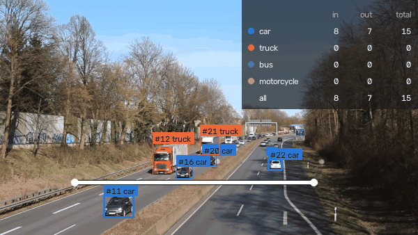
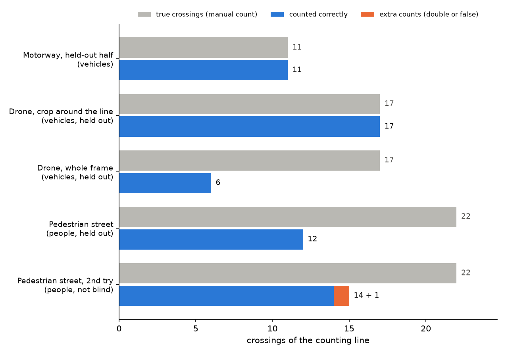
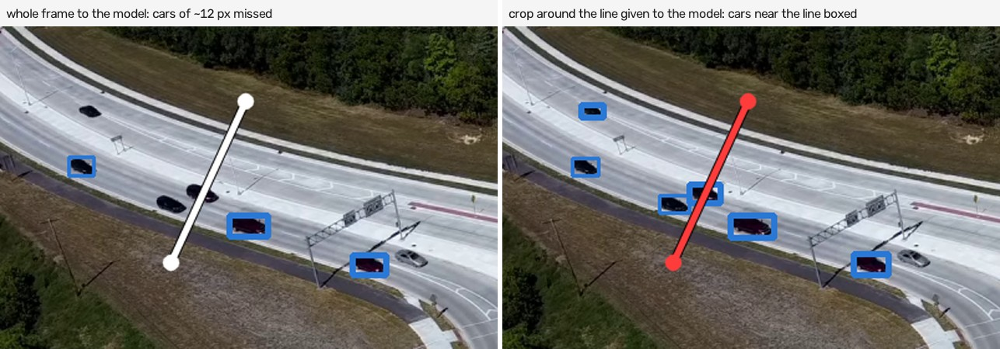
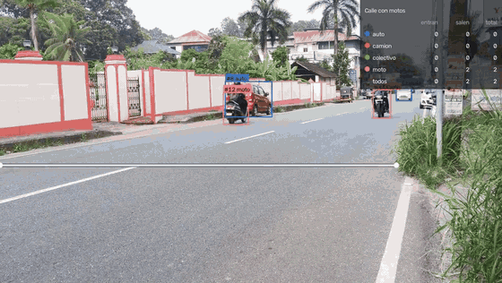
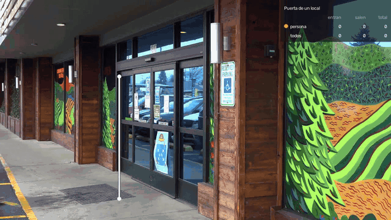

# Object Counting Demo
### Counting people and vehicles in video

You draw a line on a fixed camera's view, and the system detects, tracks and counts every person or vehicle that crosses it, by type and separating entries from exits. It runs on an ordinary computer, on recorded video or live from a webcam or an IP camera, and saves every crossing with the time and a photo.

**Tomás González** · Individual project · November 2026

[Evaluation](docs/EVALUATION.md) · [Data and licenses](docs/DATA.md) · [Leer en español](README.md)

**Result:** against a manual count made before running the model, it counted all 11 crossings on a motorway and all 17 on a roundabout filmed from a drone. On a street with motorcycles it counted all 14 vehicles that crossed, and at a shop door, all 5 people who went in or out.

Video: "Motorway A40 - on bridge above the traffic" by Kathinka Engels, CC BY 3.0, overlay added.

## How it was built

### 1. Detect

A detection model (RF-DETR) finds cars, trucks, buses, motorcycles or people in every frame. For objects that are very small in the image, such as cars seen from a drone, it can work on a crop around the line.

### 2. Track

A tracking algorithm (ByteTrack) links the detections from frame to frame and gives each object its own ID while it is in view.

### 3. Count

When an object changes side of the line, it is a crossing in that direction. Each object counts once, a small margin stops jitter on the line from adding extra counts, and the type is a vote over all frames: a car the model mistakes for a truck in two frames is still a car.

### 4. Measure it against a manual count

I picked three public videos with a fixed camera and logged every crossing by hand before running the model, then compared crossing by crossing:

| | Motorway cars and trucks | Roundabout from a drone cars of ~12 pixels | Pedestrian street crowded |
| --- | :---: | :---: | :---: |
| True crossings | 11 | 17 | 22 |
| Counted correctly | **11** | **17** | 12 |
| Right type | 11 of 11 | 16 of 17 | 12 of 12 |

### 5. Understand where it fails and fix it

- **Very small objects.** On the drone clip, shrinking the whole frame for the model left cars at about 4 pixels and it found 6 of 17. Working on a crop around the line, it found all 17.
- **Crowds.** On the pedestrian street, when several people walk close together, tracking mixes up who is who and crossings are lost. This is the method's limit: it needs a camera mounted high, looking down.

### 6. Make it real time

The accurate model analyses about 2 frames per second on a laptop: fine for recorded video, not for a live camera. I added a lighter model (YOLOX on OpenVINO), about 5 times faster, and a mode that always takes the newest frame from the camera and drops the ones it has no time for. When nothing moves, it does not analyse. Each crossing is saved the moment it happens, with the time and a photo. In real time it counted all 11 motorway crossings; with very small objects or crowds it misses more.

### 7. Try it in real-use places

**Street with motorcycles.** A two-way street with motorcycles, cars, an auto-rickshaw and a pickup, several passing very close to the camera. It counted all 14 vehicles that crossed the line, each in the right direction, with no extra counts.

[Full video](figures/casos/calle_motos.mp4) · Original video: [YouTube OifT-jm8jYY](https://www.youtube.com/watch?v=OifT-jm8jYY) (1:40 to 2:40), analysis overlay added.

**Shop door.** A shop entrance with automatic doors. The line goes across the doorway, so people walking along the pavement are not counted. It counted all 5 people who crossed: 4 in and 1 out.

[Full video](figures/casos/puerta_local.mp4) · Original video: Pexels, video 6641527 (Pexels License), analysis overlay added.

## Conclusion

Detecting, tracking and counting on a line works very well where objects pass one or a few at a time and are fully visible: a motorway, a street, a gate or a shop door. Very small objects are solved by working on a crop; crowds need a different camera position. In a real installation, the first step is to count a few minutes of that camera by hand and measure on it.

## Limits

- Few test videos: this is a demonstration, not a statistical study.
- It recognises the most common object types (cars, trucks, buses, motorcycles, people). Anything else, such as parts on a production line, needs the model trained on images of that site.
- Car, pickup and truck can be confused; the total count of vehicles is more reliable than the split by type.
- The camera must be fixed.

MIT license. Videos: "Motorway A40 - on bridge above the traffic" by Kathinka Engels (CC BY 3.0); "Roundabout 14 61" by Wikideas1 (CC0); "Video Codec Test pedestrian area" by Taurus Media Technik (CC0); Pexels 6641527 (Pexels License); and YouTube OifT-jm8jYY. All with an overlay added.
