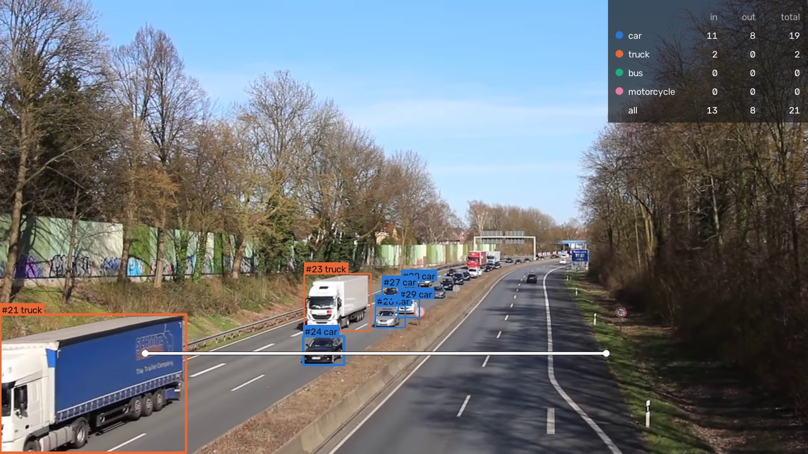
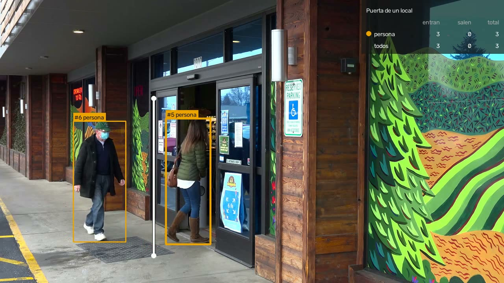

<div align="center">

# Object Counting Demo

**Count vehicles or people crossing a line in a video, by class, and check the count against a manual one.**

[](https://github.com/TomaasGonzalezzz/Object-Counting-Demo/actions/workflows/tests.yml)


[Leer en español](README.md) · [How it was evaluated](docs/EVALUATION.md) · [Data and licenses](docs/DATA.md)



<sub>Video: "Motorway A40 - on bridge above the traffic" by Kathinka Engels, CC BY 3.0, overlay added.</sub>

</div>

You draw a line on a fixed camera's view. Each object that crosses it gets a box, an ID and a class, and goes into a running count per class and direction. Out come an annotated video and a CSV of every crossing. Everything runs on a laptop CPU, and every component has a permissive license (no AGPL), so the code can go into client work.

What matters here is the evaluation. I counted every crossing in three public clips by hand before running the model, then compared.

## Results at a glance

| | Motorway<br><sub>cars and trucks, held-out half</sub> | Roundabout from a drone<br><sub>cars of ~12 px</sub> | Pedestrian street<br><sub>people, heavy occlusion</sub> |
| --- | :---: | :---: | :---: |
| Crossings in the manual count | 11 | 17 | 22 |
| Counted correctly | **11** | **17** | 12 |
| Missed / counted twice / false | 0 / 0 / 0 | 0 / 0 / 0 | 10 / 0 / 0 |
| Count error | 0 % | 0 % | **−45 %** |
| Right class | 11 of 11 | 16 of 17 | 12 of 12 |
| Speed on a laptop CPU | 2.0 frames/s | 2.0 frames/s | 2.6 frames/s |

These are small samples (50 crossings in total). Zero errors on 11 and 17 crossings means these two scenes work, not that the error rate is zero. The pedestrian clip is where the method breaks, and the reasons are [below](#what-went-wrong-on-the-way).

### Live, on a laptop

The table above processes every frame at about 2 frames per second, which is fine for recorded video but not for a live camera. For live use there is a second detector, **YOLOX-tiny on OpenVINO** (Apache-2.0, `--fast`), about 5 times faster on the same CPU, and a `--realtime` mode that plays a file at its real speed and drops the frames there is no time for, as a camera would. Each crossing is written to `events.csv` (with the time and a photo) the moment it is counted.

| Held out | True | RF-DETR, every frame | YOLOX-tiny, every frame | YOLOX-tiny, **real time** | RF-DETR, real time |
| --- | ---: | :---: | :---: | :---: | :---: |
| Motorway | 11 | 11 | 11 + 1 double | **11** | 3 |
| Roundabout (12 px cars) | 17 | 17 | 14 | 7 | 0 |
| Pedestrian street | 22 | 12 | 11 + 1 double | 9 | 0 |

In real time this laptop analyses 5 to 8 frames per second with YOLOX-tiny: enough for normal-size vehicles, not for tiny or crowded objects. Details, speeds and caveats in [docs/EVALUATION.md](docs/EVALUATION.md#a-fast-model-and-running-in-real-time).


## How it works

```text
 video ──► frames ──► RF-DETR ──► ByteTrack ──► anchor point ──► line counter ──► annotated.mp4
          (streamed,  (COCO:      (one ID per   (bottom of a     (side change,      events.csv
          ≤1280 px)   car, truck, object over   vehicle, centre  dead zone, count   counts.csv
                      bus, moto,  time)         of a person)     once, class vote)
                      person)
```

1. **Detect.** [RF-DETR](https://github.com/roboflow/rf-detr) Nano (Apache-2.0) with its COCO weights finds cars, trucks, buses, motorcycles or people in each frame. Frames are streamed one at a time, so memory does not grow with the video. For small objects the detector can work on a crop around the line (`--roi`).
2. **Track.** ByteTrack, from Roboflow's [trackers](https://github.com/roboflow/trackers) (Apache-2.0), links the boxes into one ID per object.
3. **Count.** Each track becomes one point: the bottom of the box for vehicles, the centre for people. When the point changes side of the line it is a crossing. A 2 px dead zone stops jitter on the line from counting, each track counts once, and the class is the confidence-weighted vote over the whole track, so a car labelled `truck` for two frames is still a car.
4. **Write.** The video with boxes, IDs, classes, the line and live counters per class, plus `events.csv` (frame, time, track, class, direction) and `counts.csv` (in / out / total per class).

| Input | Output |
| --- | --- |
| A video from a fixed camera and a line `x1,y1,x2,y2` | `annotated.mp4`, `events.csv`, `counts.csv`, `tracks.csv`, `run.json` (settings and speed) |

```text
$ uv run python -m linecount a40/source.webm --line 230,560,960,560 --out out --end 100
car         in    3   out    0
total 3 crossings in 100 frames, 2.8 fps -> out
```

## Evaluation

Method, definitions and per-event tables: [docs/EVALUATION.md](docs/EVALUATION.md).

- **Clips:** three Wikimedia Commons videos with a fixed camera: a German motorway seen from a bridge (CC BY 3.0), a roundabout in Wisconsin seen from a drone (CC0), and a pedestrian street in Munich (CC0). Sources are in [docs/DATA.md](docs/DATA.md).
- **Manual count:** for each clip I logged every crossing (frame, direction, class) in `evaluation/ground_truth/`, before any model run. To find them I used slit-scan images (the pixels under the line stacked over time, so each crossing leaves a mark) and checked each one on the frames.
- **Matching:** each predicted crossing is paired with at most one true crossing in the same direction, close in time and in position along the line. What is left over is *missed*, *counted twice* or a *false crossing*.
- **Held out:** I planned to tune on the first half of the motorway clip. The library defaults already got all 14 crossings there, so nothing was changed. The other half and the other two clips were run once, blind.


| Run | Clip | True | Counted | Error |
| --- | --- | ---: | ---: | ---: |
| Defaults | Motorway, first half (tuning) | 14 | 14 | 0 % |
| Defaults | Motorway, second half (held out) | 11 | 11 | 0 % |
| Defaults, detector on a crop around the line | Roundabout (held out) | 17 | 17 | 0 % |
| Defaults, whole frame | Roundabout (held out) | 17 | 6 | −65 % |
| Defaults | Pedestrian street (held out) | 22 | 12 | −45 % |
| Second try for people (not blind) | Pedestrian street | 22 | 15 (14 right, 1 false) | −32 % |

### What went wrong on the way

- **Small objects disappear on the whole frame.** On the drone clip a car is about 12 px long. The detector shrinks the whole frame to 384 px and the car falls to about 4 px: 6 of 17 found. I had already decided to also run it on a crop around the line, based on the geometry and before seeing any result. That got 17 of 17. Both runs were blind, and the [figure](docs/EVALUATION.md#small-objects-drone-clip-whole-frame) shows the same frame both ways.
- **People in a crowd: ID switches.** On the pedestrian street the tracker sometimes moves an ID from one person to another. Track #30 counts a person walking right, then jumps to a man who crosses left, and his crossing is lost because a track only counts once. That rule is what prevents double counts on the motorway, so it cannot simply be dropped.
- **Tracks that break right at the line.** In a group walking together, IDs end a few frames before the line and new ones start a few frames after it. No ID is ever seen on both sides, so nothing counts. One woman crosses completely hidden behind a man close to the lens, and no camera could have counted her.
- **The second try fixed little.** For people only, I lowered the detection threshold and let lost tracks live twice as long. It got 14 right instead of 12, but the longer memory made one ID jump between two people and add a false crossing. Since I tuned this after seeing the clip's errors, **that number is not blind**. I stopped there: 22 crossings are too few to tune on.
- **An evaluation bug at a boundary.** One car was crossing at frame 353 in my count and at 362 in the model's, on different sides of the tuning/held-out split, so the first score was off by one. Pairs are now assigned by the frame of the true crossing.
- **Speed.** About 2 frames per second on this laptop's CPU, roughly 15 times slower than real time for 30 fps video. Processing every second frame (`--stride 2`) halves the cost and still counted all 25 motorway crossings. A GPU would be the real fix; I have not measured one.

### One more case: a shop door

After the evaluation above, I tried the same counter on a shop entrance with automatic doors, the kind of place where a shop would want to count visitors. The line goes across the doorway; people walking along the pavement never cross it.



It counted all 5 people who went through the door, in the right direction: 4 in and 1 out (RF-DETR, every frame, 20 s clip). I checked every crossing on the frames after the run, so this one is not a blind test.

<sub>Video: Pexels, video 6641527 (Pexels License), overlay added.</sub>

## Limits

- 50 crossings in three clips, counted by one person. Logged frames are accurate to about ±10 frames. This is a demo, not a benchmark. With a client, the first step is counting 10 to 15 minutes of their own camera by hand and measuring on that.
- COCO classes only (car, truck, bus, motorcycle, person, ...). Anything else, such as parts on a production line or specific vehicle types, needs a model fine-tuned on that client's images. RF-DETR supports that, but it is not done here.
- Crowds of people seen from eye level are not solved. A camera mounted high and looking down reduces occlusion a lot, and that is what I would ask for in a real installation.
- Car vs. truck is ambiguous for SUVs, vans and pickups. The count of vehicles is more reliable than the split by class.
- The camera must be fixed. Lines and crops are drawn by hand per camera.
- The CLI writes MPEG-4 Part 2 (`mp4v`), which plays in VLC and desktop players but not in every browser. `python -m linecount.figures` re-encodes a clip to H.264 for the web (written to `figures/web/`, not tracked).

## Roadmap (not built yet)

Production-line extensions I plan to build on the same detect, track and rules pipeline. None of these exist in this repository yet:

- **Missing part or part removal alerts:** an object that should stay in a zone leaves it, or disappears, outside the expected step (possible theft).
- **Process deviation:** a part in the wrong place, or a step skipped in the expected order.
- **Presence or absence checks on an assembly:** every expected component is there before the piece moves on.
- **Dimensional measurement at a fixed station:** size of a part from a calibrated camera.
- **Counting on a conveyor or at a gate:** the same line counter, with a model trained on the client's parts.

## Quick start

Requires [uv](https://docs.astral.sh/uv/). Runs on CPU; weights are downloaded on first use (RF-DETR ~350 MB into `RF_HOME`, YOLOX into `LINECOUNT_HOME`).

```sh
uv sync
uv run python -m linecount.demo                                                         # the three clips, live in a window
uv run python -m linecount video.mp4 --line x1,y1,x2,y2 --out out/                    # vehicles, accurate model
uv run python -m linecount video.mp4 --line x1,y1,x2,y2 --out out/ --classes people   # people
uv run python -m linecount video.mp4 --line ... --out out/ --roi x1,y1,x2,y2           # small objects: detect on a crop
uv run python -m linecount video.mp4 --out out/ --fast --show                         # draw the line with the mouse, fast model, watch live
uv run python -m linecount 0 --out out/ --fast --show --classes people                # webcam
uv run python -m linecount "rtsp://user:pass@ip:554/..." --out out/ --fast --motion   # IP camera, model only runs on motion
uv run pytest                                                                          # unit tests
```

Line coordinates are in pixels of the frame after it is scaled to at most 1280 px wide; the program prints that size. Without `--line`, a window opens on the first frame: click the two ends of the line, optionally right-drag a crop, and press Enter (`python -m linecount.pick video.mp4` only prints the coordinates). `--lang es` puts the on-screen labels in Spanish. On Windows, run modules with `uv run python -m ...` as above.

Reproduce the evaluation (clips go outside the repo):

```sh
uv run python -m linecount.data --out ../external-data/counting/raw
uv run python -m linecount.evaluate run --config final --data ../external-data/counting/raw
uv run python -m linecount.evaluate summary --config final --also baseline:roundabout,people_v2:pedestrian_area
uv run --group web python -m linecount.figures --data ../external-data/counting/raw --runs ../external-data/counting/runs
```

The commands for the comparison runs are in [docs/EVALUATION.md](docs/EVALUATION.md#reproduce).

## Project layout

```text
src/linecount/
  video.py      streamed frame reading (files, webcams, RTSP cameras with newest-frame reading) and video writing
  detect.py     RF-DETR (PyTorch) and YOLOX (OpenVINO) detectors: class filter, optional crop around the line
  motion.py     cheap frame-difference check that lets the pipeline skip the detector on still frames
  count.py      line geometry and the crossing counter (dead zone, count once, class vote)
  draw.py       overlay: boxes, IDs, classes, the line, per-class counters (English or Spanish)
  pipeline.py   video in -> detect -> track -> count -> annotated video and CSVs, optional live window
  cli.py        command line (python -m linecount)
  pick.py       draw the line and the crop with the mouse
  demo.py       one-command live demo on the three clips (python -m linecount.demo)
  slitscan.py   tools used to build the manual count (slit-scan images, frame crops)
  evaluate.py   matching against the manual count, metrics, results/summary.json
  data.py       downloads the clips from Wikimedia Commons
  figures.py    README figures and web assets, redrawn from saved runs
evaluation/     clips and lines, configurations, manual counts, figure settings
results/        metrics, predicted events and per-event matches for each run; summary.json
figures/        README images
docs/           evaluation details, data sources and licenses
tests/          unit tests (crossing logic on synthetic tracks, matching, YOLOX decoding, motion gate)
```

Licenses of every dependency are listed in [docs/DATA.md](docs/DATA.md#software-and-model-licenses). The optional `web` group (PyAV, only used to encode the web clip) bundles an FFmpeg build that includes GPL encoders. It is not used by the counting code.

---

Tomás González · AI Engineering student, Universidad de San Andrés (Argentina).
No video is stored in this repository; the evaluation clips are downloaded from Wikimedia Commons. Frames in `figures/` come from "Motorway A40 - on bridge above the traffic" by Kathinka Engels (CC BY 3.0), "Roundabout 14 61" by Wikideas1 (CC0), "Video Codec Test pedestrian area" by Taurus Media Technik (CC0) and Pexels video 6641527 (Pexels License), with an overlay added.
