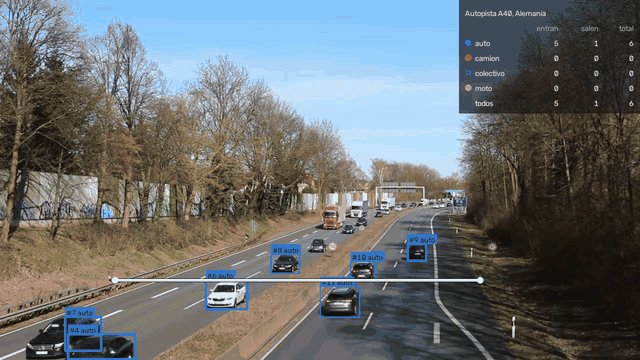

# Object Counting Demo
### Conteo de personas y vehículos en video

Sobre la imagen de una cámara fija se marca una línea, y el sistema detecta, sigue y cuenta cada persona o vehículo que la cruza, por tipo y separando entradas de salidas. Corre en una computadora común, sobre video grabado o en vivo desde una webcam o una cámara IP, y guarda cada cruce con la hora y una foto.

**Tomás González** · Proyecto individual · noviembre de 2026

[Evaluación](docs/EVALUATION.md) · [Datos y licencias](docs/DATA.md) · [Read in English](README.en.md)

**Resultado:** contra un conteo hecho a mano antes de correr el modelo, contó bien los 11 cruces de una autopista y los 17 de una rotonda filmada desde un dron. En una calle con motos contó los 14 vehículos que cruzaron, y en la puerta de un local, las 5 personas que entraron o salieron.

Video: "Motorway A40 - on bridge above the traffic", de Kathinka Engels, CC BY 3.0, con anotaciones agregadas.

## Recorrido

### 1. Detectar

Un modelo de detección (RF-DETR) encuentra autos, camiones, colectivos, motos o personas en cada cuadro del video. Para objetos muy chicos en la imagen, como autos vistos desde un dron, puede trabajar sobre un recorte alrededor de la línea.

### 2. Seguir

Un algoritmo de seguimiento (ByteTrack) une las detecciones de cuadro a cuadro y le da a cada objeto un número propio mientras está en imagen.

### 3. Contar

Cuando un objeto cambia de lado de la línea, cuenta como un cruce, en el sentido que corresponda. Cada objeto cuenta una sola vez, un pequeño margen evita que el temblequeo sobre la línea sume de más, y el tipo se decide por votación entre todos los cuadros: un auto que el modelo confunde con un camión en dos cuadros sigue siendo un auto.

### 4. Medirlo contra un conteo hecho a mano

Elegí tres videos públicos con cámara fija y anoté cada cruce a mano antes de correr el modelo. Después comparé, cruce por cruce:

| | Autopista autos y camiones | Rotonda desde un dron autos de ~12 píxeles | Peatonal gente amontonada |
| --- | :---: | :---: | :---: |
| Cruces reales | 11 | 17 | 22 |
| Contados bien | **11** | **17** | 12 |
| Tipo correcto | 11 de 11 | 16 de 17 | 12 de 12 |

### 5. Entender dónde falla y corregirlo

- **Objetos muy chicos.** En el video del dron, al achicar el cuadro entero para el modelo, los autos quedaban de unos 4 píxeles y encontró 6 de 17. Trabajando sobre un recorte alrededor de la línea encontró los 17.
- **Gente amontonada.** En la peatonal, cuando varias personas caminan pegadas, el seguimiento confunde quién es quién y se pierden cruces. Ahí el método llega a su límite: hace falta una cámara alta, que mire hacia abajo.

### 6. Llevarlo a tiempo real

El modelo preciso analiza unos 2 cuadros por segundo en una notebook: sirve para video grabado, no para una cámara en vivo. Sumé un modelo más liviano (YOLOX en OpenVINO), unas 5 veces más rápido, y un modo que toma siempre el cuadro más reciente de la cámara y descarta los que no llega a analizar. Si no se mueve nada, no analiza. Cada cruce se guarda en el momento, con la hora y una foto. En tiempo real contó bien los 11 cruces de la autopista; con objetos muy chicos o gente amontonada pierde más.

### 7. Probarlo en lugares de uso real

**Calle con motos.** Una calle de doble mano con motos, autos, un mototaxi y una camioneta, varios pasando muy cerca de la cámara. Contó los 14 vehículos que cruzaron la línea, cada uno en su sentido y sin conteos de más.

[Video completo](figures/casos/calle_motos.mp4) · Video original: [YouTube OifT-jm8jYY](https://www.youtube.com/watch?v=OifT-jm8jYY) (1:40 a 2:40), con el análisis agregado.

**Puerta de un local.** La entrada de un comercio con puertas automáticas. La línea va sobre la puerta, así que quien pasa por la vereda no se cuenta. Contó las 5 personas que cruzaron: 4 entraron y 1 salió.

[Video completo](figures/casos/puerta_local.mp4) · Video original: Pexels, video 6641527 (licencia Pexels), con el análisis agregado.

## Conclusión

Detectar, seguir y contar por línea funciona muy bien donde los objetos pasan de a uno o de a pocos y se ven enteros: una autopista, una calle, un portón o la puerta de un local. Los objetos muy chicos se resuelven trabajando sobre un recorte; las multitudes piden otra ubicación de cámara. En una instalación real, lo primero es contar a mano unos minutos de la propia cámara y medir sobre eso.

## En una sola consola

Este conteo también funciona dentro de la [búsqueda en grabaciones](https://github.com/TomaasGonzalezzz/Video-Search-Demo), como la pestaña *Conteo*: se ve contar sobre el video del día, y mover la línea vuelve a contar todo lo grabado sin analizar el video de nuevo.

## Límites

- Pocos videos de prueba: es una demostración, no un estudio estadístico.
- Reconoce los tipos de objeto más comunes (autos, camiones, colectivos, motos, personas). Para otra cosa, como piezas de una línea de producción, hay que entrenar el modelo con imágenes del lugar.
- Entre auto, camioneta y camión puede confundirse; el total de vehículos es más confiable que la separación por tipo.
- La cámara tiene que estar fija.

Licencia MIT. Videos: "Motorway A40 - on bridge above the traffic", de Kathinka Engels (CC BY 3.0); "Roundabout 14 61", de Wikideas1 (CC0); "Video Codec Test pedestrian area", de Taurus Media Technik (CC0); Pexels 6641527 (licencia Pexels); y YouTube OifT-jm8jYY. Todos con anotaciones agregadas.
