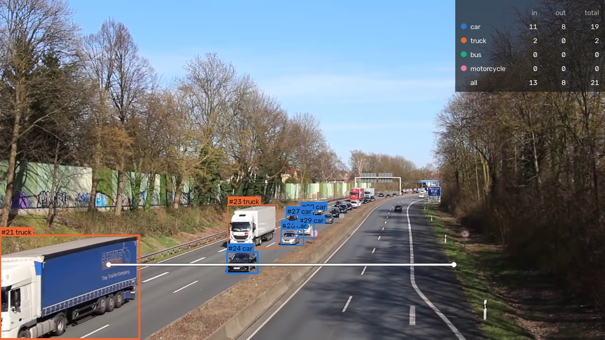
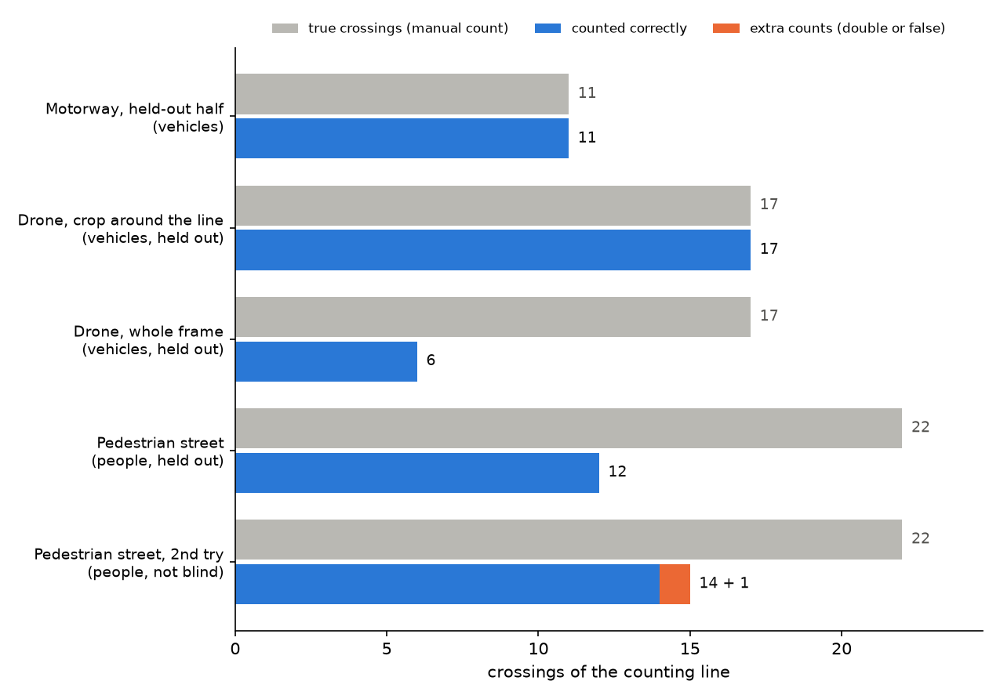
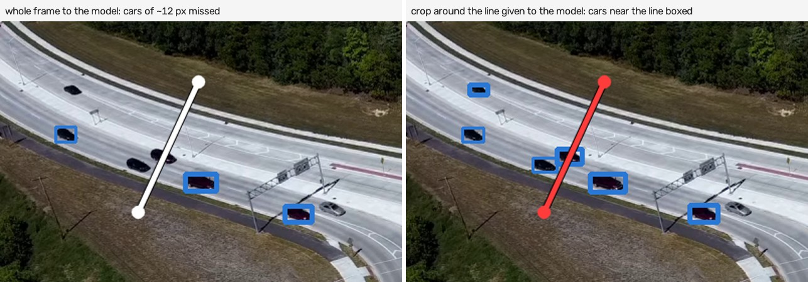
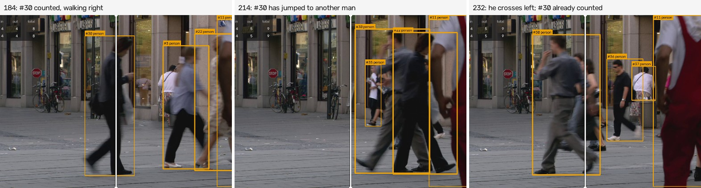
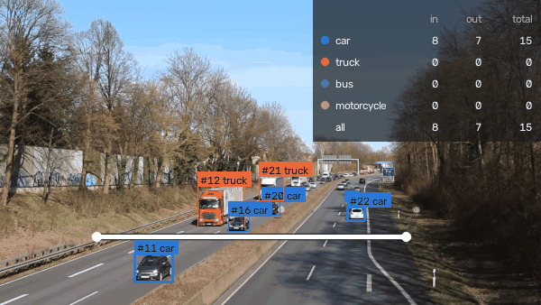
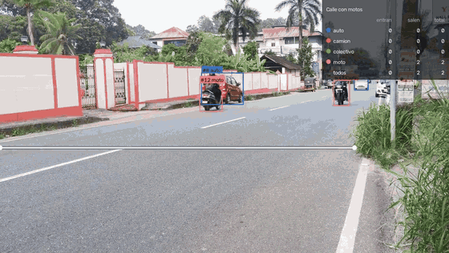
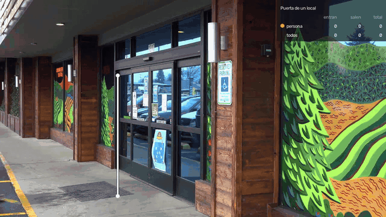

# Object Counting Demo
### Conteo de personas y vehículos en video

Sobre la imagen de una cámara fija se marca una línea, y el sistema detecta, sigue y cuenta cada persona o vehículo que la cruza, por clase y separando entradas de salidas. Corre en el procesador de una notebook, sobre video grabado o en vivo desde una webcam o una cámara IP, y guarda cada cruce con la hora y una foto.

**Tomás González** · Proyecto individual · noviembre de 2026

[Cómo se evaluó](docs/EVALUATION.md) · [Datos y licencias](docs/DATA.md) · [Read in English](README.en.md)

**Resultado:** contra un conteo hecho a mano antes de correr el modelo, contó bien los 11 cruces reservados de una autopista y los 17 de una rotonda filmada desde un dron. En una peatonal llena de gente contó 12 de 22: ahí está el límite del método.



<sub>Video: "Motorway A40 - on bridge above the traffic", de Kathinka Engels, CC BY 3.0, con anotaciones agregadas.</sub>

## Recorrido

```text
 video ──► cuadros ──► RF-DETR ──► ByteTrack ──► punto de ──► contador de ──► annotated.mp4
          (de a uno,   (COCO: auto, (un ID por    referencia   línea (cambio    events.csv
          ≤1280 px)    camión,      objeto en     (base del    de lado, zona    counts.csv
                       colectivo,   el tiempo)    vehículo,    muerta, cuenta
                       moto,                      centro de    una vez, voto
                       persona)                   la persona)  de clase)
```

### 1. Detectar

[RF-DETR](https://github.com/roboflow/rf-detr) Nano (Apache-2.0), con los pesos de COCO, encuentra autos, camiones, colectivos, motos o personas en cada cuadro. Los cuadros se leen de a uno, así que la memoria no crece con el largo del video. Para objetos chicos, el detector puede trabajar sobre un recorte alrededor de la línea (`--roi`).

### 2. Seguir

ByteTrack, de la librería [trackers](https://github.com/roboflow/trackers) de Roboflow (Apache-2.0), une las cajas de cuadro a cuadro en un ID por objeto.

### 3. Contar

Cada track se reduce a un punto: la base de la caja para vehículos, el centro para personas. Cuando el punto cambia de lado de la línea, es un cruce. Una zona muerta de 2 px evita que el temblequeo sobre la línea cuente, cada track cuenta una sola vez, y la clase sale de votar en todos los cuadros del track, ponderando por confianza: un auto que aparece como `truck` en dos cuadros sigue siendo un auto.

### 4. Medirlo contra un conteo hecho a mano

Usé tres videos de Wikimedia Commons con cámara fija: una autopista alemana desde un puente, una rotonda en Wisconsin desde un dron y una peatonal de Múnich. Anoté cada cruce (cuadro, sentido, clase) **antes** de correr el modelo; para encontrarlos usé imágenes *slit-scan*, que apilan en el tiempo los píxeles que están bajo la línea, así cada cruce deja una marca. Cada cruce predicho se empareja con a lo sumo uno real del mismo sentido, cercano en tiempo y en posición. La idea era ajustar con la primera mitad de la autopista, pero con los valores por defecto ya contaba bien los 14 cruces, así que no cambié nada. El resto se corrió una sola vez, a ciegas.

| | Autopista<br><sub>autos y camiones, mitad reservada</sub> | Rotonda desde un dron<br><sub>autos de ~12 px</sub> | Peatonal<br><sub>personas, mucha oclusión</sub> |
| --- | :---: | :---: | :---: |
| Cruces en el conteo manual | 11 | 17 | 22 |
| Contados bien | **11** | **17** | 12 |
| Perdidos / contados dos veces / falsos | 0 / 0 / 0 | 0 / 0 / 0 | 10 / 0 / 0 |
| Error del conteo | 0 % | 0 % | **−45 %** |
| Clase correcta | 11 de 11 | 16 de 17 | 12 de 12 |
| Velocidad en CPU de notebook | 2,0 cuadros/s | 2,0 cuadros/s | 2,6 cuadros/s |



Son muestras chicas (50 cruces en total): cero errores en 11 y en 17 cruces dice que estas dos escenas funcionan, no que el error sea cero. El detalle por cruce está en [docs/EVALUATION.md](docs/EVALUATION.md).

### 5. Entender qué salió mal

- **En el cuadro entero, los objetos chicos desaparecen.** En el video del dron un auto mide unos 12 px. El detector achica el cuadro a 384 px y el auto queda en unos 4 px: encontró 6 de 17. Antes de ver ningún resultado ya había decidido correrlo también sobre un recorte alrededor de la línea, y así encontró 17 de 17.



- **Gente amontonada: cambios de ID.** En la peatonal, el tracker a veces pasa un ID de una persona a otra, y ese cruce se pierde porque cada track cuenta una sola vez. Esa misma regla es la que evita los conteos dobles en la autopista, así que no se puede sacar sin más.
- **Tracks que se cortan justo en la línea.** En un grupo que camina junto, los IDs terminan unos cuadros antes de la línea y aparecen IDs nuevos después: ningún ID se ve de los dos lados y no cuenta nada. Una mujer cruza tapada por completo por un hombre pegado a la cámara: ninguna cámara la podría haber contado.



- **El segundo intento arregló poco.** Solo para personas, bajé el umbral de detección y dejé que los tracks perdidos vivan el doble. Contó 14 bien en vez de 12, pero sumó un cruce falso, y como lo ajusté después de ver los errores, **ese número no es a ciegas**. Paré ahí: 22 cruces son muy pocos para ajustar.
- **Un bug de la evaluación en un borde.** Un auto cruzaba en el cuadro 353 según mi conteo y en el 362 según el modelo, a cada lado del corte entre ajuste y reserva. Ahora cada par se asigna según el cuadro del cruce real.

### 6. Llevarlo a tiempo real

RF-DETR procesa unos 2 cuadros por segundo: sirve para video grabado, no para una cámara en vivo. Para vivo sumé un segundo detector, **YOLOX-tiny en OpenVINO** (Apache-2.0, `--fast`), unas 5 veces más rápido en el mismo procesador, y un modo `--realtime` que reproduce un archivo a su velocidad real y descarta los cuadros que no llega a analizar, como pasaría con una cámara. Con `--motion`, el detector solo corre cuando algo se mueve. Cada cruce se escribe en `events.csv`, con la hora y una foto, en el momento en que se cuenta.

| Parte reservada | Reales | RF-DETR, cada cuadro | YOLOX-tiny, cada cuadro | YOLOX-tiny, **tiempo real** | RF-DETR, tiempo real |
| --- | ---: | :---: | :---: | :---: | :---: |
| Autopista | 11 | 11 | 11 + 1 doble | **11** | 3 |
| Rotonda (autos de 12 px) | 17 | 17 | 14 | 7 | 0 |
| Peatonal | 22 | 12 | 11 + 1 doble | 9 | 0 |

En tiempo real esta notebook analiza entre 5 y 8 cuadros por segundo con YOLOX-tiny: alcanza para vehículos de tamaño normal, no para objetos muy chicos o amontonados.



### 7. Dos casos más: una calle con motos y la puerta de un local

Después de la evaluación probé el mismo contador en dos lugares más cercanos a un uso real. En los dos verifiqué cada cruce sobre los cuadros después de la corrida, así que no son a ciegas (RF-DETR).

**Calle con motos.** Una calle de doble mano con motos, autos, un mototaxi y una camioneta, varios pasando muy cerca de la cámara. Contó los 14 vehículos que cruzaron la línea, cada uno en su sentido y sin conteos de más. En el tipo se equivocó con 3: dos motos que marcó como auto y el mototaxi, que no es una clase de COCO y lo contó como camión. Dos motos entran a la imagen por el costado, ya pasada la línea, y no cuentan.



<sub>[Video completo](figures/casos/calle_motos.mp4) (1 minuto) · Video original: [YouTube, OifT-jm8jYY](https://www.youtube.com/watch?v=OifT-jm8jYY) (tramo 1:40 a 2:40), con el análisis agregado.</sub>

**Puerta de un local.** La entrada de un comercio con puertas automáticas, donde a un local le interesaría saber cuánta gente entra. La línea va sobre la puerta: quien pasa por la vereda no la cruza. Contó bien las 5 personas que cruzaron la puerta: 4 entraron y 1 salió.



<sub>[Video completo](figures/casos/puerta_local.mp4) · Video original: Pexels, video 6641527 (licencia Pexels), con el análisis agregado.</sub>

## Conclusión

Detectar, seguir y contar por línea funciona muy bien donde los objetos pasan de a uno o de a pocos y se ven enteros: una autopista, una calle, un portón, la puerta de un local. Los problemas aparecen con objetos muy chicos en el cuadro, que se resuelven trabajando sobre un recorte, y con multitudes que se tapan entre sí, que piden otra ubicación de cámara (alta, mirando hacia abajo). Con un cliente, el primer paso sería contar a mano 10 a 15 minutos de su propia cámara y medir sobre eso.

## Cómo usarlo

Necesita [uv](https://docs.astral.sh/uv/). Corre en CPU; los pesos se descargan la primera vez (RF-DETR, ~350 MB, en `RF_HOME`; YOLOX en `LINECOUNT_HOME`).

```sh
uv sync
uv run python -m linecount.demo                                                            # los tres videos, en vivo en una ventana
uv run python -m linecount video.mp4 --line x1,y1,x2,y2 --out salida/                    # vehículos, modelo preciso
uv run python -m linecount video.mp4 --line x1,y1,x2,y2 --out salida/ --classes people   # personas
uv run python -m linecount video.mp4 --line ... --out salida/ --roi x1,y1,x2,y2           # objetos chicos: detectar en un recorte
uv run python -m linecount video.mp4 --out salida/ --fast --show --lang es               # dibujar la línea con el mouse, modelo rápido, ver en vivo
uv run python -m linecount 0 --out salida/ --fast --show --classes people --lang es      # webcam
uv run python -m linecount "rtsp://usuario:clave@ip:554/..." --out salida/ --fast --motion   # cámara IP, el modelo corre solo si hay movimiento
uv run pytest                                                                             # tests
```

Las coordenadas de la línea van en píxeles del cuadro ya escalado a 1280 px de ancho como máximo; el programa imprime ese tamaño. Sin `--line` se abre una ventana sobre el primer cuadro: dos clics marcan la línea, arrastrando con el botón derecho se marca un recorte, y Enter confirma. `--lang es` pone las etiquetas de pantalla en español.

Para reproducir la evaluación (los videos quedan fuera del repositorio):

```sh
uv run python -m linecount.data --out ../external-data/counting/raw
uv run python -m linecount.evaluate run --config final --data ../external-data/counting/raw
uv run python -m linecount.evaluate summary --config final --also baseline:roundabout,people_v2:pedestrian_area
```

## Límites

- 50 cruces en tres videos, contados por una sola persona, con los cuadros anotados a ±10 cuadros. Es una demo, no un benchmark.
- Solo clases de COCO (auto, camión, colectivo, moto, persona, etc.). Piezas en una línea de producción o tipos específicos de vehículo necesitan un modelo entrenado con imágenes del lugar; RF-DETR lo permite, pero acá no está hecho.
- Auto o camión es ambiguo para SUVs, utilitarios y pickups: el total de vehículos es más confiable que la separación por clase.
- La cámara tiene que estar fija, y la línea se marca a mano para cada cámara.
- La línea de comandos escribe MPEG-4 Part 2 (`mp4v`), que se ve en VLC y en reproductores de escritorio pero no en todos los navegadores.

## Estructura

```text
src/linecount/
  video.py      lectura de cuadros de a uno (archivos, webcams y cámaras RTSP tomando siempre el cuadro más nuevo) y escritura de video
  detect.py     detectores RF-DETR (PyTorch) y YOLOX (OpenVINO): filtro de clases y recorte opcional alrededor de la línea
  motion.py     chequeo barato de movimiento para no correr el detector en cuadros quietos
  count.py      geometría de la línea y contador de cruces (zona muerta, cuenta una vez, voto de clase)
  draw.py       anotaciones: cajas, IDs, clases, la línea y los contadores por clase (en inglés o español)
  pipeline.py   video -> detectar -> seguir -> contar -> video anotado y CSVs, con ventana en vivo opcional
  cli.py        línea de comandos (python -m linecount)
  pick.py       dibujar la línea y el recorte con el mouse
  demo.py       demo en vivo de los tres videos con un solo comando (python -m linecount.demo)
  slitscan.py   herramientas para armar el conteo manual (slit-scan, recortes de cuadros)
  evaluate.py   comparación con el conteo manual, métricas y results/summary.json
  data.py       descarga los videos de Wikimedia Commons
  figures.py    figuras del README, redibujadas desde corridas guardadas
evaluation/     videos y líneas, configuraciones, conteos manuales, ajustes de figuras
results/        métricas, cruces predichos y emparejamientos de cada corrida; summary.json
figures/        imágenes del README
docs/           detalle de la evaluación, fuentes de datos y licencias (en inglés)
tests/          lógica de cruce sobre tracks sintéticos, emparejamiento, decodificación de YOLOX, filtro de movimiento
```

Licencia MIT. Las licencias de todas las dependencias están en [docs/DATA.md](docs/DATA.md#software-and-model-licenses). El repositorio no guarda videos: los de la evaluación se descargan de Wikimedia Commons. Los cuadros de `figures/` salen de "Motorway A40 - on bridge above the traffic", de Kathinka Engels (CC BY 3.0), "Roundabout 14 61", de Wikideas1 (CC0), "Video Codec Test pedestrian area", de Taurus Media Technik (CC0), y del video 6641527 de Pexels (licencia Pexels), con anotaciones agregadas.
