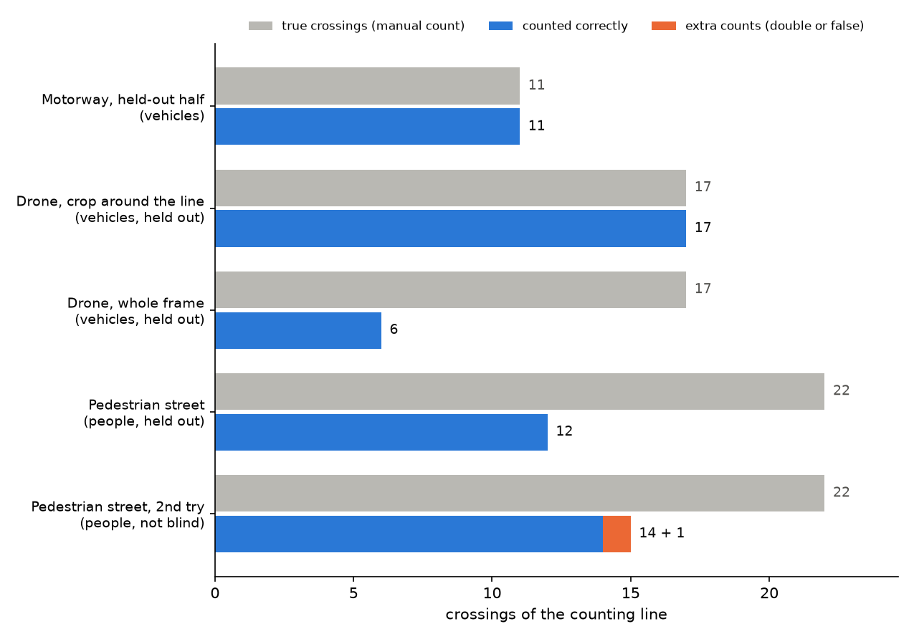
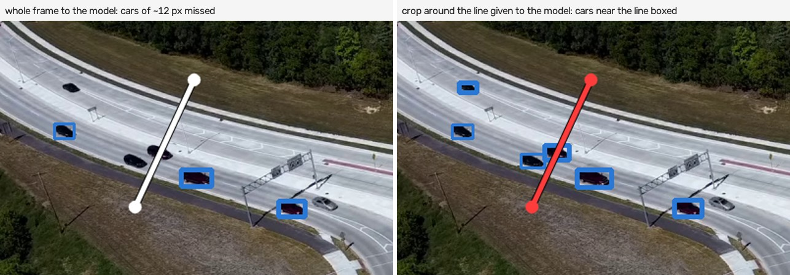
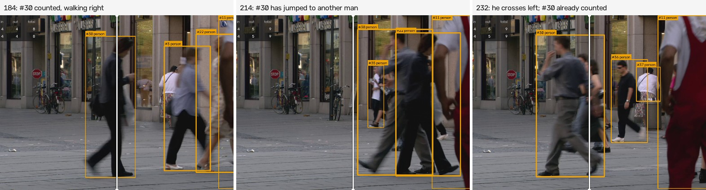
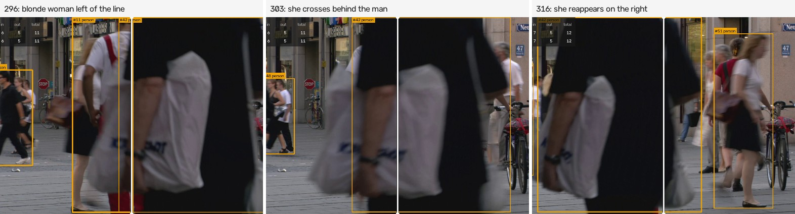

# How it was evaluated

The question: **if a person counted the objects crossing the line by hand, would they get the same number as the program?** This page covers how the manual count was made, how predictions are matched to it, the results per clip, and what fails.

Every number here comes from `results/` and can be reproduced with the commands at the end.

## Setup

| | |
| --- | --- |
| Machine | Windows 11 laptop, Intel Core i7-10510U (4 cores, 1.8 GHz), 16 GB RAM, no GPU |
| Detector | RF-DETR Nano (`rfdetr` 1.12), COCO weights, no fine-tuning, 384 px input, confidence threshold 0.5 |
| Tracker | ByteTrack from Roboflow `trackers` 2.7 with its default settings (new track at confidence ≥ 0.7, two-stage matching split at 0.6, 2 frames to confirm a track, 30-frame memory for lost tracks) |
| Counter | `linecount.count.LineCounter`: anchor at the bottom-centre of the box for vehicles and the centre for people, 2 px dead zone around the line, each track counted at most once, class = confidence-weighted vote over the track's frames |
| Frames | every frame, downscaled to 1280 px wide |

## Clips

| Clip | Objects | Frames | Why it is here |
| --- | --- | --- | --- |
| `a40` | cars and trucks, both directions | 735 (24.5 s) | the standard case: fixed camera above a road |
| `roundabout` | cars seen from a drone, about 12 px long at 1280 px | 872 (36.4 s) | small objects |
| `pedestrian_area` | people walking in every direction, many close to the lens | 375 (15 s) | occlusion and crowds |

Sources and licenses are in [DATA.md](DATA.md). Lines are in `evaluation/clips.json`.

## Ground truth

For each clip I logged every crossing by hand in `evaluation/ground_truth/<clip>.csv`: frame, direction, position along the line, class, and a short description. **All three files were written before the model was run on any clip**, and no row was changed after seeing results.

How the crossings were found:

1. **Slit-scan images** (`uv run python -m linecount.slitscan`). The pixels under the counting line are sampled in every frame and stacked over time, so each object that crosses leaves one blob and a whole clip fits in a few images. This works well for the two vehicle clips.
2. **Frame crops** (`--crops FIRST LAST STEP`) of the area around the line, tiled with frame numbers, to confirm each blob, read its direction and settle doubtful cases. One example: two dark bands next to trucks on the motorway turned out to be the trucks' shadows, not cars. For the pedestrian clip, where people overlap, I followed each person through crops taken every 5 frames and then every 4 frames around the busy moments.

Definitions and caveats:

- A crossing happens when the object's anchor point crosses the line (the bottom of the vehicle, the middle of the person). Logged frames are accurate to about ±10 frames: shadows make the exact moment fuzzy on the motorway, and walking people have no sharp edge. Matching allows for this (see below).
- **Evaluation windows.** Crossings in the first 0.5 s are excluded on both sides, because a tracker cannot count an object it has not seen before the line. The same applies to the last 0.5 s. For `pedestrian_area` the window is frames 45 to 344. In the first 1.8 s a woman walks away right in front of the lens and hides the line, with a dense crowd behind her. The last second is a crowd I could not count reliably by eye. Both stretches are excluded from the manual count and from the predictions.
- On `roundabout`, one object of about 8 px at the road edge (frame 723, probably a cyclist) is marked `ignore`. It is too small to identify, so it is neither counted nor penalised.
- One annotator, no second pass by another person. For the pedestrian clip I would put the uncertainty of the manual count at ±1 or 2 people.

## Matching and metrics

A predicted crossing is matched to a true one (Hungarian assignment, one to one) when it has the same direction and falls within the tolerance: 20 frames and 120 px along the line on `a40`, 15 frames and 40 px on `roundabout`, and 15 frames and 300 px on `pedestrian_area`, where position along a vertical line says little. Inside the window:

- **correct**: matched pairs;
- **missed**: true crossings with no prediction;
- **double count**: an extra prediction next to a true crossing that is already matched (the same object counted twice);
- **false crossing**: any other extra prediction;
- **count error** = (predicted − true) / true;
- **class accuracy** = correct crossings with the right class / correct crossings.

A matched pair belongs to the window of its true crossing, so a crossing near a split boundary is never counted on only one side. The code is `linecount/evaluate.py`, with unit tests in `tests/test_evaluate.py`.

## Tuning and held-out data

The plan was to tune on the first half of `a40` (frames 15 to 359) and report the second half and the other two clips without touching them.

- **There was nothing to tune.** With library defaults, the first half came out 14 of 14 correct, 0 extra. I kept the defaults. I also tried processing every second frame (`stride2`): still 14 of 14 on the first half, at about half the CPU time per second of video. I kept every frame for the reported numbers.
- **Crop around the line on the drone clip.** The cars there are about 12 px long. Before running anything I decided to give the detector a crop around the line, the line's bounding box plus 120 px (`roi` in `clips.json`), chosen from the geometry. Both versions were run and both were blind.
- **Pedestrians.** The first run was blind. After looking at its errors I tried one more setting for people only (`people_v2`). **Its number is not blind**, and it is reported as a second try.

## Results

Configuration `final` (defaults, plus the line crop on the drone clip):

| Clip | Window | True | Counted | Error | Correct | Missed | Double | False | Class accuracy |
| --- | --- | ---: | ---: | ---: | ---: | ---: | ---: | ---: | ---: |
| `a40`, first half (used for tuning) | 15–359 | 14 | 14 | 0 % | 14 | 0 | 0 | 0 | 14/14 |
| `a40`, second half (held out) | 360–719 | 11 | 11 | 0 % | 11 | 0 | 0 | 0 | 11/11 (7 cars, 4 trucks) |
| `roundabout` (held out) | 15–856 | 17 | 17 | 0 % | 17 | 0 | 0 | 0 | 16/17 |
| `pedestrian_area` (held out) | 45–344 | 22 | 12 | −45.5 % | 12 | 10 | 0 | 0 | 12/12 |

Comparison runs:

| Run | Clip | True | Counted | Error | Correct | Missed | Extra |
| --- | --- | ---: | ---: | ---: | ---: | ---: | ---: |
| `baseline`: whole frame to the detector | `roundabout` | 17 | 6 | −64.7 % | 6 | 11 | 0 |
| `people_v2`: second try on people (**not blind**) | `pedestrian_area` | 22 | 15 | −31.8 % | 14 | 8 | 1 false |
| `stride2`: every second frame | `a40`, second half | 11 | 11 | 0 % | 11 | 0 | 0 |



Per-event detail (which true crossing matched which track, and every miss or extra) is in `results/<config>/<clip>_<split>_matches.csv`.

### Speed

Measured on the laptop above, end to end (decode, detect, track, count, draw, encode):

| Clip | Frames per second | Detector time per frame |
| --- | ---: | ---: |
| `a40` | 1.97 | 482 ms |
| `roundabout` (line crop) | 1.96 | 473 ms |
| `roundabout` (whole frame) | 2.35 | 411 ms |
| `pedestrian_area` | 2.62 | 351 ms |
| `a40` with `stride2` | 1.78 processed, 3.56 frames of video per second | 555 ms |

That is about 15 times slower than real time for 30 fps video. Almost all of it is the detector on the CPU. The detector time per frame moved between about 350 and 560 ms across runs, and a first quick benchmark on a cold machine gave 210 ms for Nano. Laptop CPU throttling is the likely cause, so treat these as rough figures. Nothing was measured on a GPU.

## A fast model, and running in real time

A counter at a gate has to keep up with the camera and log each crossing as it happens. At 0.5 s per frame, RF-DETR cannot do that on this laptop, so I added a second detector and a way to test the whole pipeline under live conditions.

### Why not just optimise RF-DETR

Exporting RF-DETR Nano and running it with other engines barely helped, because the model itself is heavy for a 15 W CPU. Detector time per frame, same frames, same laptop:

| Model | Engine | ms per frame |
| --- | --- | ---: |
| RF-DETR Nano | PyTorch | ~480 |
| RF-DETR Nano | ONNX Runtime (CPU) | ~610 |
| RF-DETR Nano | OpenVINO (CPU) | ~425 |
| RF-DETR Nano | OpenVINO (Intel UHD graphics) | ~670 |
| YOLOX-tiny | OpenVINO (CPU) | ~100 |
| YOLOX-nano | OpenVINO (CPU) | ~40 |

These are the best of several measurements. The laptop was shared with other work during this session, and the same measurement moved by up to 3× between runs, so read them as orders of magnitude.

### Configuration `fast`: YOLOX-tiny, every frame

YOLOX-tiny (Apache-2.0) on OpenVINO, threshold 0.3 (YOLOX's own demo default), ByteTrack defaults. On the A40 tuning half only, the whole frame missed 2 of 14 crossings and a crop around the line (`130,400,1060,720`) missed only one that was cut off by the end of that test run, so the crop was kept for A40. The drone clip keeps its crop, the pedestrian clip the whole frame. Fixed before running anything else, then run once, blind.

| Clip | True | `final` (RF-DETR) | `fast` (YOLOX-tiny) |
| --- | ---: | --- | --- |
| `a40`, first half (tuning) | 14 | 14 correct | 14 correct |
| `a40`, second half (held out) | 11 | 11 correct | 11 correct + 1 double count (a truck split into two tracks, labelled `bus`) |
| `roundabout` (held out) | 17 | 17 correct | 14 correct, 3 missed |
| `pedestrian_area` (held out) | 22 | 12 correct | 11 correct, 11 missed, 1 double count |

The small model is about as good on vehicles of normal size and on people, and loses on the 12 px cars of the drone clip.

### Real-time runs (`fast_realtime`, `accurate_realtime`)

With `realtime`, each clip is played at its own speed on a background thread and the counter always takes the newest frame, dropping the ones it had no time for, exactly as with a camera. Same settings as `fast` and `final`; nothing was tuned for these runs.

| Clip | True | YOLOX-tiny, real time | RF-DETR Nano, real time |
| --- | ---: | --- | --- |
| `a40`, first half | 14 | 10 correct, 4 missed | 7 correct, 7 missed |
| `a40`, second half | 11 | **11 correct** | 3 correct, 8 missed, 2 false |
| `roundabout` | 17 | 7 correct, 10 missed | 0 |
| `pedestrian_area` | 22 | 9 correct, 13 missed | 0 correct, 1 false |
| Frames analysed | | 18–31 % (5–8 per second) | about 4 % (under 1 per second) |

- **RF-DETR cannot run live on this laptop.** At under one analysed frame per second the tracker never sees an object twice near the line.
- **YOLOX-tiny keeps up on the motorway** (all 11 held-out crossings) at 5–8 analysed frames per second.
- **It loses small or crowded objects.** Between two analysed frames a 12 px car moves more than its own length, so the tracker cannot link the boxes and no single ID is seen on both sides of the line. In the crowd, fewer frames make the occlusion problem worse.
- **The result depends on how many frames per second get analysed**, which depends on how much CPU is free. This run analysed 5.3 frames per second on the motorway and missed 4 of 14 crossings in the first half. A shorter run made earlier the same evening, same settings, frames 15 to 299, analysed 7.6 per second and counted all 11 crossings in that stretch, including the 4 missed here (not saved in `results/`; it was a quick check). These runs were made while other programs were also using the CPU.

What this means for a real installation: a gate or a door, with large objects that move slowly and a camera placed for the job, is the easy case for this pipeline. Small or fast objects in real time need more analysed frames per second: a faster box (an accelerator such as a Hailo or Jetson module, or a GPU), YOLOX-nano, a tighter crop, the camera's low-resolution sub-stream, and `--motion` so idle frames cost nothing.

## Error analysis

### Small objects (drone clip, whole frame)

Given the whole 1280x720 frame, the detector resizes it to 384x384 and a 12 px car shrinks to about 4 px. It found 6 of 17 crossings. With the crop around the line (300x310 px, enlarged to 384), it found 17 of 17. The one class error is a white SUV or pickup labelled `truck`; at that size I marked it as ambiguous in the ground truth.



### People: ID switches, broken tracks and full occlusion

The pedestrian clip missed 10 of 22 crossings and made no false count. Going through `tracks.csv` for each miss turned up three causes:

1. **An ID jumps to another person, and a track is only counted once.** Track #30 counts a person walking right at frame 186. By frame 214 the same ID sits on a different man, who then crosses to the left at frame 228. Because #30 was already counted, his crossing is lost. The count-once rule is what prevents double counts on the motorway; here it costs a miss.
2. **The track breaks right at the line.** In a group of three women walking together, the tracks end a few frames before the line and new IDs start a few frames after it. No single ID is ever seen on both sides, so nothing is counted.
3. **Full occlusion.** One woman crosses entirely behind a man walking close to the lens. Nothing could have seen her.





**Second try (`people_v2`, tuned on this clip).** Detector threshold 0.25 instead of 0.5, new tracks allowed from confidence 0.5, and lost tracks kept for 60 frames instead of 30. The aim was to keep one ID through partial occlusion. It got 14 correct, 8 missed and 1 false crossing: the longer memory let track 67 jump from a person on the left of the line (frame 261) to a different person on the right (frame 270). I stopped there. More tuning on 22 crossings would fit this clip and say little about the next one.

### Motorway

No errors in either half. One thing worth knowing: in frame 640 the white truck right under the camera, seen from behind, has no box. It was detected a few frames later, before it reached the line, so the count was not affected. A line placed lower in the image would have missed it.

### What went wrong on the way

- **An evaluation bug at the split boundary.** The first scoring of the tuning half said 13 of 14 predicted, yet every crossing was matched. A car crossed at frame 353 by the manual count and at frame 362 by the model, on different sides of the split at 360. Pairs are now assigned by the frame of the true crossing.
- **ByteTrack moved out of `supervision`.** In `supervision` 0.31 the tracker lives in Roboflow's separate `trackers` package (Apache-2.0), which is now a dependency.
- **A run was killed for low memory.** The system stopped the final run partway through the pedestrian clip. The other two clips had finished and been saved, so only that clip was rerun.
- **Clips that did not work.** Two street clips had scene cuts or a panning camera, and the scramble-crossing clips were hand-held. A fixed camera is a requirement of this method.

## Reproduce

```sh
uv sync
uv run python -m linecount.data --out ../external-data/counting/raw     # ~50 MB from Wikimedia Commons
$env:RF_HOME = "../external-data/counting/weights"                      # PowerShell; export RF_HOME=... in bash
uv run python -m linecount.evaluate run --config final --data ../external-data/counting/raw
uv run python -m linecount.evaluate run --config baseline --clips roundabout --data ../external-data/counting/raw --no-video
uv run python -m linecount.evaluate run --config people_v2 --clips pedestrian_area --data ../external-data/counting/raw
uv run python -m linecount.evaluate run --config stride2 --clips a40 --data ../external-data/counting/raw --no-video
uv run python -m linecount.evaluate run --config fast --data ../external-data/counting/raw                 # YOLOX-tiny weights go to LINECOUNT_HOME
uv run python -m linecount.evaluate run --config fast_realtime --data ../external-data/counting/raw --no-video
uv run python -m linecount.evaluate run --config accurate_realtime --data ../external-data/counting/raw --no-video
uv run python -m linecount.evaluate summary --config final --also baseline:roundabout,people_v2:pedestrian_area
uv run --group web python -m linecount.figures --data ../external-data/counting/raw --runs ../external-data/counting/runs
```

`uv run python -m linecount.evaluate score --config final` re-scores the saved predictions without running the model. CI runs it on every push.
